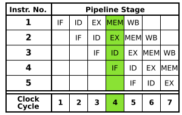

# Pipelined RV32 CPU for DE10-Lite

A readable SystemVerilog RV32IMA core with Zicsr and Zifencei, a tournament branch predictor, machine/user modes, and a small FPGA system. The DE10-Lite port of [rv32-microkernel](https://github.com/alkhameri/rv32-microkernel) boots in Verilator, runs its producer/consumer threads, and handles timer-driven context switches.

The CPU, shared RAM, timer, and serial transmitter are all RTL. The DE10-Lite does not need a built-in ARM processor: the MAX 10 FPGA implements the processor and its peripherals. This design uses 128 KiB of on-chip RAM and does not require the board's external SDRAM.

**Current validation:** Verilator 5.052, warning-clean lint, independent instruction-model comparisons, directed firmware, and complete-system kernel simulation. Quartus synthesis, resource usage, timing closure, and physical-board execution have not been measured. The 50 MHz clock constraint is a target, not a verified Fmax. This is not an ISA certification or formal proof.

## Build and test

Requirements: Verilator, a C++17 compiler, Make, Python 3, and a bare-metal RISC-V GCC toolchain with an RV32IM multilib. On macOS:

```sh
brew install verilator riscv64-elf-gcc
make test test-soc
```

For a toolchain named `riscv64-unknown-elf-gcc`, pass `CROSS=riscv64-unknown-elf-`. The compiler prefix can say RV64; `-march=rv32ima_zicsr_zifencei -mabi=ilp32` selects RV32 code. Build products are in `build/`. `make -C sim` forwards to the root build. No test downloads dependencies automatically.

- `make lint`: lint the core and the DE10-Lite wrapper with warnings treated as errors.
- `make test`: predictor and PMP tests, six instruction-model comparisons, an ALU throughput check, and two firmware runs with different memory delays.
- `make test-soc`: run the same firmware against the synthesizable RAM and peripherals.
- `make test-kernel`: build an already-prepared kernel port, run it on the CPU model, then run it on the complete RTL system while decoding the actual UART TX pin.

Run a compatible ELF directly, optionally recording retirement and trap events:

```sh
build/core/Vrv32_core --elf build/tests.elf --seed 71 --trace build/retirement.log
```

The loader requires little-endian ELF32, entry `0x80000000`, no compressed instructions, and load segments that fit in 128 KiB. It loads ELF segments and zero-fills BSS. Unmapped accesses produce bus faults instead of wrapping into RAM. The simulator times out with failure if a program does not complete its expected test.

## Run your microkernel

The supported upstream revision is `fb52e338ee3f3c3dfcfcdf76d80e95510c535e92`. Prepare a copy; the upstream checkout is not edited:

```sh
mkdir -p build
KERNEL_REV=fb52e338ee3f3c3dfcfcdf76d80e95510c535e92
curl -fL "https://codeload.github.com/alkhameri/rv32-microkernel/tar.gz/$KERNEL_REV" -o build/kernel-source.tar.gz
tar -xzf build/kernel-source.tar.gz -C build
python3 tools/prepare_kernel.py "build/rv32-microkernel-$KERNEL_REV" build/kernel
make test-kernel
```

Archive SHA-256: `43a477cf681c782f36ad6dc2492d3a5a73b433ca4d367cbdde6ea59268f53bc8`.

`ports/rv32-microkernel-de10.patch` is a separate, reviewable software port. It:

1. Builds without compressed instructions, selects RV32 software helpers explicitly, and links libgcc for 64-bit division used by the logger.
2. Changes the RAM limit from 128 MiB to 128 KiB and includes `.sbss` in startup clearing.
3. Initializes `gp` at boot and restores `sp` from the selected thread's saved trap frame on trap return.
4. Replaces the Sv32 setup with a physical-address implementation of the VM entry points.

The current upstream kernel and its threads execute in M mode. Writing `satp` does not translate normal M-mode accesses. This core has M/U modes and PMP, with no S mode, page-table walker, TLB, or Sv32. The port therefore does not promise the upstream VM subsystem's future functionality. An original RV32IMAC binary must be rebuilt for this target.

Both simulation paths require boot output, activity from both threads, and at least three timer interrupts. The RTL system includes real UART serialization and status polling. Long-running console output can interleave when the kernel logs from an interrupt; the port does not change the upstream logger's synchronization policy.

## Pipeline and design choices



Stage-overlap diagram by Inductiveload, [Wikimedia Commons](https://commons.wikimedia.org/wiki/File:5_Stage_Pipeline.svg), public domain. Included unchanged. The stage order matches this core: instruction fetch, decode/register read, execute, memory access, then writeback. The image shows ideal overlap; our fetch buffering, stalls, forwarding, prediction, and trap handling are described below.

Five execution stages balance synchronous FPGA RAM access, a short arithmetic path, and branch recovery cost. The frontend also has a held request, one outstanding transaction, and a two-entry instruction FIFO. Its buffering is explicit; this is not a claim that all fetches have a fixed five-cycle latency. Selecting a different stage count needs actual Quartus area and timing comparisons.

- Each stage has a valid bit. MEM backpressure holds EX. A held EX instruction captures bypassed operands so a retiring producer cannot disappear while a load or multiply stalls.
- WB-to-ID, WB-to-EX, and completed MEM-to-EX forwarding cover ALU, branch, address, and store-data dependencies. A dependent load waits for its response.
- Branches and jumps resolve in EX. Recovery compares actual and predicted next PCs, including stale target predictions on non-control instructions.
- Data transactions issue only from MEM. Older faults suppress younger branches, stores, CSR changes, and predictor training. Faulting instructions do not retire or write a destination register.
- CSR, fence, privilege, and atomic instructions drain the pipeline. Interrupts stop decode and drain older work before saving the next architectural PC.
- Multiply and divide use 32 iterative steps rather than a large combinational unit on the ALU path. Divide by zero and signed overflow follow RV32M semantics.
- Atomics serialize a read/modify/write pair, retain a memory lock, and return the old word. LR/SC reservations clear on stores, AMOs, trap entry, MRET, or explicit invalidation. Acquire/release ordering follows from the single outstanding, ordered data path.
- WFI is implemented as a legal M-mode hint, without clock gating. Misaligned instruction targets and naturally misaligned data accesses trap. Unsupported instructions and CSRs trap.

### Branch prediction

The predictor contains 256 two-bit bimodal counters, 256 gshare counters, a 256-entry two-bit chooser, an eight-bit global history, a 64-entry two-way target cache with full tags, and an eight-entry return stack. It recognizes both x1 and x5 call/return hints and pop-then-push coroutine calls.

Fetch carries the original table indices and predictor votes to EX. Training uses that metadata, not a recomputed index with a newer history. Only resolved nonfaulting instructions update history and the return stack. This avoids speculative recovery state, at the cost of less recent history for closely spaced branches. A full return stack overwrites its oldest entry; prediction errors still recover normally.

Trap entry, MRET, FENCE.I, and CSR writes clear predictor state as appropriate for context/code changes. A runtime control CSR allows sequential prediction for comparisons. There are no instruction or data caches, and FENCE.I drains and refetches instructions after stores to code.

### Privilege and observability

Implemented CSRs include `mstatus`, `misa`, `mie`, `mip`, `mtvec`, `mscratch`, `mepc`, `mcause`, `mtval`, `mcounteren`, `mcountinhibit`, 64-bit cycle/retirement counters, time reads, machine identification, and four PMP entries. PMP supports TOR, NA4, NAPOT, locks, priority, access containment, and MPRV. User counter access respects `mcounteren`. `mtvec` supports direct and vectored interrupts. Core interrupt inputs cover machine software, timer, and external interrupts; the board system wires software and timer sources.

| Custom machine CSR | Behavior |
| --- | --- |
| `0x7c0` | Bit 0 enables prediction, reset value 1. Every write clears prediction tables. Other bits read zero. |
| `0x7c1` | Resolved nonfaulting branch/jump count, writable for reset or profiling. |
| `0x7c2` | EX next-PC misprediction count, including stale targets, excluding serialized redirects. |
| `0x7c3` | Cycles spent waiting in MEM, writable for reset or profiling. |

Custom counters wrap at 32 bits. The core also exposes retirement PC, instruction, destination, value, next PC, and privilege, plus separate trap PC/cause/value signals. This is a debug interface, not a complete RVFI implementation.

## Memory interface

Instruction and data ports use separate request and response valid/ready handshakes. Acceptance occurs on a rising edge with both valid and ready asserted. A response must arrive at least one cycle later and stay stable until accepted. There is at most one outstanding transaction per port, with a new request allowed on the cycle its predecessor's response is consumed.

Held requests survive stalls and redirects. Stale instruction responses are drained and discarded. Data addresses are word-aligned; byte strobes identify the accessed lanes and write data is shifted into those lanes. Reads return the full aligned word. Error responses must not perform a store. Reset must also reset the attached bus transactions.

`dmem_request_atomic` requires an atomic-capable region; MMIO atomics return an access fault in the supplied system. `dmem_lock` covers the atomic transaction, including both halves of an AMO. The supplied SoC is single-hart and has no DMA or second data master. An external arbiter must honor that lock and present reservation invalidations before lock ownership, never mutate RAM concurrently with a locked sequence. This is not a cache-coherent multicore bus.

| Address | Peripheral |
| --- | --- |
| `0x80000000` through `0x8001ffff` | 128 KiB unified, byte-writeable RAM; reset PC `0x80000000` |
| `0x02000000` | Hart 0 software interrupt, bit 0 |
| `0x02004000`, `0x02004004` | `mtimecmp` low/high words |
| `0x0200bff8`, `0x0200bffc` | `mtime` low/high words, 10 MHz at a 50 MHz core clock |
| `0x10000000` | UART transmit byte |
| `0x10000005` | UART line status; bits 5 and 6 indicate idle |
| `0x10000010` | Test completion mailbox; value 1 means pass |

The console implements the polled transmit subset used by the kernel, not a full 16550. UART receive, PLIC, SDRAM, debug/JTAG, compressed instructions, floating point, supervisor mode, and virtual memory are not implemented. The USB-Blaster programs the FPGA; it is not this UART console.

## DE10-Lite build

`make test-kernel` produces `build/firmware.hex`. To use another compatible ELF:

```sh
python3 tools/elf2hex.py path/to/program.elf build/firmware.hex
```

Open `fpga/de10_lite.qpf` in Quartus Prime Lite with MAX 10 device support, or run from the `fpga/` directory:

```sh
quartus_sh --flow compile de10_lite
```

The tracked project targets `10M50DAF484C7G` and embeds the RAM image. It replaces the obsolete local `quartus project/` project. Check successful M9K inference, resource fit, and all core timing paths before programming. No bitstream or timing report is supplied by this change.

Clock: the on-board 50 MHz input. Reset: KEY0, with synchronized release. UART TX: Arduino D1 (`PIN_AB6`), 115200 baud, 8N1. Connect it to the RX input of a **3.3 V TTL** serial adapter and share ground. LED9 is a heartbeat, LED8 latches any trap, and LED7:0 show retired PC bits 9:2. Timer interrupts are traps, so LED8 lighting during kernel execution is expected.

## Verification evidence

The checked run used Verilator 5.052 and GCC 16.2.0. `make test test-soc test-kernel` passed:

- 28,435 random-program retirements compared against an independent RV32IMA interpreter, including final data RAM comparisons, with five randomized-latency seeds and one one-cycle-memory run.
- A dependent ALU stream retired 516 instructions in 524 cycles, including startup and test exit. This measures an ideal instruction stream, not application IPC.
- Directed firmware exercised lane/sign handling, jumps, M-extension corner cases, atomics/LR-SC, CSR semantics, illegal instructions, misalignment, access faults, self-modifying code, user permissions, MPRV, PMP locks, software interrupts, vectored dispatch, and prediction disable. Each run handled 22 expected traps. PMP unit tests also check empty TOR ranges, overlapping regions, full access containment, and address-space boundaries.
- On an alternating-branch unit workload after warmup, the tournament predictor made 896/896 correct direction predictions; the standalone two-bit bimodal baseline made 0/896. This is a targeted correlation test, not a general accuracy claim. Target-cache associativity, return-stack selection, coroutine hints, clearing, and disable are checked separately.
- The adapted kernel reached timer tick 3 with both worker threads active after 333,826 retired instructions and 1,580,494 cycles with randomized memory latency. The complete RTL system decoded the same milestones from its serial pin after 1,869,714 cycles.

The simulations are bounded smoke and regression tests. Upstream architectural compliance suites, formal proofs, longer kernel stress runs, synthesis, and hardware tests remain useful next validation steps.

## Source map and references

[`rv32_core.sv`](rtl/rv32_core.sv) is the structural CPU top: signal declarations and module connections. Each hardware module has its own file. As in the original CPU's structural top, the ALU, register file, and control logic are separate components; the pipeline stages now have explicit ownership of their state.

| Module | Responsibility and owned state |
| --- | --- |
| [`rv32_pkg`](rtl/rv32_pkg.sv) | Shared operation enums and typed pipeline, bypass, trap, and predictor-update payloads. No hardware state. |
| [`rv32_fetch`](rtl/rv32_fetch.sv) | IF requests, outstanding-response tracking, and the instruction FIFO feeding ID. |
| [`rv32_predictor`](rtl/rv32_predictor.sv) | Direction tables, target cache, history, and return stack. |
| [`rv32_decode_stage`](rtl/rv32_decode_stage.sv) | Connects the instruction decoder and register file; forms the ID/EX payload. |
| [`rv32_decode`](rtl/rv32_decode.sv) | Instruction legality, control decoding, and immediate extraction. |
| [`rv32_regfile`](rtl/rv32_regfile.sv) | Architectural registers, x0 protection, and WB-to-ID bypass. |
| [`rv32_execute_stage`](rtl/rv32_execute_stage.sv) | Owns ID/EX state; connects forwarding, ALU, multiply/divide, and data PMP checks; resolves branches and detects EX faults. |
| [`rv32_alu`](rtl/rv32_alu.sv) | Combinational integer arithmetic, shifts, and comparisons. |
| [`rv32_forwarding`](rtl/rv32_forwarding.sv) | Selects EX operands, giving completed MEM writes priority over WB writes. |
| [`rv32_muldiv`](rtl/rv32_muldiv.sv) | Iterative multiply/divide state and result handshake. |
| [`rv32_memory_stage`](rtl/rv32_memory_stage.sv) | Owns EX/MEM state, data transactions, lane handling, AMO sequencing, and LR/SC reservation; produces precise faults and commit strobes. |
| [`rv32_writeback_stage`](rtl/rv32_writeback_stage.sv) | Owns MEM/WB state and the architectural resume PC; produces retirement and register-write outputs. |
| [`rv32_pipeline_control`](rtl/rv32_pipeline_control.sv) | Combinational stall, serialization, interrupt-drain, and redirect priority decisions. |
| [`rv32_csr`](rtl/rv32_csr.sv), [`rv32_pmp`](rtl/rv32_pmp.sv) | Privilege/CSR state and combinational protection checks. |
| [`rv32_soc`](rtl/rv32_soc.sv) | Connects the core, shared RAM, timer, and UART. [`de10_lite_top`](rtl/de10_lite_top.sv) supplies board clock, reset, and pins. |

Pipeline payloads carry data separately from valid bits. The receiving stage owns each pipeline register. `decode_fire` accepts ID into EX, and `execute_fire` transfers EX into MEM. `completion_valid` transfers a nonfaulting MEM instruction into WB. EX saves forwarded operands even while held; MEM can finish one instruction and accept its successor on the same edge. The pipeline controller prevents younger transfers on an architectural redirect. These boundaries preserve the existing five-stage timing and external core interface.

`rtl/files.f` gives package-first compilation order; `fpga/de10_lite.qsf` includes the same core modules for Quartus. `sim/core_sim.cpp` supplies the independent reference model and latency-injecting bus; `sim/soc_sim.cpp` tests the physical UART waveform. Firmware and kernel-port changes are kept outside the RTL.

ISA behavior follows the [RISC-V specifications](https://docs.riscv.org/reference/isa/), particularly [RV32I](https://docs.riscv.org/reference/isa/v20260120/unpriv/rv32.html), [Zicsr](https://docs.riscv.org/reference/isa/v20260120/unpriv/zicsr.html), and the [machine-level architecture](https://docs.riscv.org/reference/isa/priv/machine.html). Board context is available from [Terasic's DE10-Lite page](https://www.terasic.com.tw/cgi-bin/page/archive.pl?Language=English&No=1021).
